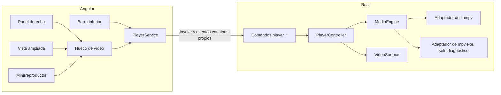

# Media Center — Arquitectura

Estado del documento: propuesta de estructura, con la segunda revisión aplicada. La sección «Interfaz Angular implementada» describe el código que existe tras F1.3, «Motor experimental de F1.4 y F1.5» el estudio de libmpv, y «Organización del motor del producto» lo que se construirá en F7.1.  
Última actualización: 2026-11-09.

Este documento reparte responsabilidades entre la interfaz, la lógica y los datos. El procedimiento de copia y movimiento y la extracción de portadas están confirmados en [DECISIONS.md](DECISIONS.md). La integración de libmpv está elegida (DC-17). El esquema inicial de SQLite está aprobado (DC-18) en [DATABASE.md](DATABASE.md) y la migración 1 lo crea al arrancar. Las rutas están decididas (DC-22). La herramienta de etiquetas sigue abierta. Angular no ejecuta SQL.

## Vista general

Media Center es un proceso de escritorio. Angular dibuja la interfaz. Rust, a través de Tauri 2, administra la ventana, el sistema de archivos, SQLite, los procesos externos y el motor multimedia.

```
Interfaz Angular
    comandos y eventos de Tauri
Servicios de aplicación en Rust
    repositorio SQLite
    archivos de la carpeta administrada
    imágenes en disco
    diario de operaciones de archivo
    adaptador del motor multimedia
    adaptador de descarga
    adaptador de etiquetas
```

La interfaz pide acciones y muestra estado. No abre la base de datos, no mueve archivos y no lanza yt-dlp, FFmpeg ni el motor de vídeo por su cuenta.

## Capas

| Capa | Responsabilidad | Tecnología prevista |
| --- | --- | --- |
| Interfaz | Navegación, listas, formularios, reproductor visible y progreso | Angular y TypeScript |
| Aplicación | Casos de uso: importar, editar, reproducir, descargar, reconciliar, recuperar operaciones | Rust |
| Datos | Fichas, archivos físicos, vínculos, playlists, lotes de descarga, diario y ajustes | SQLite, mediante un módulo de acceso usado solo por la capa de aplicación |
| Archivos | Medios administrados e imágenes | Sistema de archivos |
| Adaptadores | Motor, descarga y etiquetas | Interfaces internas. La implementación del motor se elige al comienzo del desarrollo |

La separación sigue el criterio del proyecto: interfaz, lógica de negocio y acceso a datos en módulos distintos.

## Distribución prevista del repositorio

La tarea F1.1 creó esta distribución en la raíz del repositorio:

```
src/            Interfaz Angular
public/         Archivos estáticos de Angular
src-tauri/      Aplicación Rust y configuración de Tauri
docs/           Documentación de producto
```

Angular compila en `dist/media-center/browser`. Tauri carga esa misma ruta (`frontendDist`) en la versión compilada, y `http://localhost:4200` (`devUrl`) durante el desarrollo. No se crea un segundo proyecto para probar libmpv: la integración se estudia en esta misma aplicación.

Las carpetas `library/`, `downloads/` y `data/` de la raíz están ignoradas por Git para no versionar material local. No son la ruta de la aplicación: los datos viven en el directorio local de Tauri (DC-22).

El instalador de Windows es el empaquetado de esta aplicación de escritorio. No añade un servidor. Su formato y la inclusión de libmpv, FFmpeg y yt-dlp están pendientes en [DECISIONS.md](DECISIONS.md).

## Interfaz Angular implementada

Esta sección describe el código que existe después de F1.3. La interfaz es un armazón visual: no hay biblioteca, importación ni reproducción. Angular no ejecuta SQL. Rust abre la base al arrancar.

Angular 22 funciona sin zonas (`zoneless`). Todos los componentes son standalone, usan `ChangeDetectionStrategy.OnPush` y guardan su estado en signals. No se usan `@angular/router` ni `@angular/forms`.

### Estructura de `src/`

```
src/
  styles.scss                   Estilos globales
  styles/
    _tokens.scss                Variables de diseño
    _breakpoints.scss           Puntos de corte
  app/
    app.ts, app.html, app.scss  Contenedor principal
    navigation/
      navigation.ts             Bibliotecas y secciones
      navigation.service.ts     Sección activa
    layout/
      sidebar/                  Menú lateral
      library-view/             Zona central de una biblioteca
      now-playing-panel/        Panel derecho
      player-bar/               Barra inferior
    shared/
      icon/                     Iconos SVG
      empty-state/              Estado vacío reutilizable
      describe-error.ts         Texto legible de un error de invoke
    bridge/
      bridge.service.ts         Comprobación del puente con Rust
    engine/
      engine.service.ts         Comandos y eventos del motor experimental
      video-surface.directive.ts  Recuadro reservado para el vídeo nativo
    diagnostics/
      diagnostics-view/         Vista «Diagnóstico»
      bridge-diagnostics/       Comprobación del puente con Rust
      engine-diagnostics/       Prueba del motor de F1.4
```

Cada componente tiene su archivo `.spec.ts` con pruebas de Vitest.

### App como contenedor principal

`App` no tiene lógica de negocio. Sus responsabilidades son:

- Colocar las cuatro zonas en una rejilla CSS: menú lateral, zona central, panel derecho y barra inferior.
- Leer de `NavigationService` la sección activa y elegir qué se muestra en la zona central: `LibraryViewComponent` con la biblioteca activa o, en la sección de diagnóstico, `DiagnosticsViewComponent`.
- Dar a cada zona su elemento semántico: `main` para la zona central, `aside` con `aria-label="Ahora suena"` para el panel y `section` con `aria-label="Controles de reproducción"` para la barra inferior. El menú aporta su propio `nav`.

Cada zona tiene `min-width: 0` y su propio desplazamiento, para que el contenido de una no desborde a las demás.

### Navegación provisional

`navigation.ts` define:

- `LibraryId`: `music`, `video` y `movie`.
- `Section`: una biblioteca o `diagnostics`.
- `LIBRARIES`: nombre, icono y textos del estado vacío de Música, Vídeos y Películas.

`NavigationService` (`providedIn: 'root'`) guarda la sección activa en un signal privado que empieza en Música. Expone:

| Miembro | Uso |
| --- | --- |
| `section` | Signal de solo lectura con la sección activa |
| `currentLibrary` | Signal calculado con la biblioteca activa, o `null` si la sección es el diagnóstico |
| `select(section)` | Cambia la sección |

Es una navegación provisional: no hay rutas ni URL, y la sección no se conserva al reiniciar la aplicación. Cambiar de sección solo sustituye el contenido de la zona central. Si más adelante se adopta un router, podrá sustituir a este servicio sin tocar las zonas.

### Componentes de layout

| Componente | Implementado | Previsto, no implementado |
| --- | --- | --- |
| `SidebarComponent` | Logotipo y nombre. `nav` «Bibliotecas» con un botón por biblioteca, marcado con `aria-current="page"` cuando está activo. Sección de playlists con un estado vacío. Entrada «Diagnóstico» al pie, solo en desarrollo | Lista de playlists y su creación |
| `LibraryViewComponent` | Recibe la biblioteca con `input.required`. Muestra el encabezado (icono, «Biblioteca» y nombre en `h1`) y un contenedor con el estado vacío de esa biblioteca | Vistas de lista y de cuadrícula con fichas reales, dentro del mismo contenedor |
| `NowPlayingPanelComponent` | Título «Ahora suena» y un hueco cuadrado con el estado «Sin reproducción» | Portada, vídeo original o vídeo asociado del elemento en reproducción |
| `PlayerBarComponent` | «Nada en reproducción», botones anterior, reproducir y siguiente, barra de posición y volumen. Todos deshabilitados, con nombre accesible y un `title` que avisa de que el reproductor llegará más adelante | Conexión con el controlador único de reproducción en Rust |

Ningún componente de layout llama a Rust ni guarda datos.

### Componentes reutilizables

- `IconComponent` (`app-icon`): dibuja un SVG en línea de 24 × 24 con el trazo en `currentColor` y `aria-hidden`. Los trazados son propios y están en el mismo archivo, sin dependencias. `IconName` reúne los nombres disponibles: `logo`, `music`, `video`, `movie`, `playlist`, `diagnostics`, `play`, `previous`, `next`, `volume` y `now-playing`. El tamaño sale de la variable `--icon-size`.
- `EmptyStateComponent` (`app-empty-state`): icono en un círculo, título y texto opcional. Entradas: `icon` y `heading` obligatorias, `text` y `compact`. La variante compacta se usa en el menú y en el panel derecho.

### Diagnóstico entre Angular y Rust

`BridgeDiagnosticsComponent` contiene la comprobación de F1.2: los botones «Probar conexión con Rust» y «Provocar un fallo», deshabilitados mientras hay una llamada en curso, y un mensaje con `role="status"`. La respuesta se marca en verde, el fallo provocado en ámbar y el error de comunicación en rojo.

El componente llama a `BridgeService`, que es el único punto que usa `invoke` y que distingue respuesta, fallo provocado y error de comunicación. En Rust responde el comando `bridge_check`.

La entrada «Diagnóstico» del menú solo se dibuja cuando `isDevMode()` es verdadero. En la compilación de producción no aparece, y la sección no es alcanzable desde la interfaz. Es una herramienta de desarrollo, no una función del producto.

`DiagnosticsViewComponent` muestra el encabezado «Diagnóstico» y dos tarjetas: la del puente y la del motor de F1.4 y F1.5.

### Motor experimental de F1.4 y F1.5

Es el estudio con el que se cerró DP-01: la integración elegida es A (DC-17). El código del diagnóstico no es el reproductor del producto, que se construye a partir de F7.1. B se conserva aquí por ahora como alternativa descartada para el producto. En Rust solo se compila con `debug_assertions` en Windows, y en Angular solo se usa desde el diagnóstico.

- `src-tauri/src/engine/` define el trait `EngineBackend` y un `EngineManager` que mantiene una sola reproducción. Tiene dos implementaciones:
  - A, `libmpv.rs`: libmpv dentro del proceso.
  - B, `mpv_process.rs`: `mpv.exe` controlado por JSON IPC.
- Los comandos `engine_*` abren, pausan, saltan (`relative+exact`), detienen, leen pistas y colocan la superficie. El estado llega a Angular con el evento `engine-state`.
- Desde F1.5 también eligen la pista de audio o de subtítulos, añaden un subtítulo externo y ponen a pantalla completa la ventana de Tauri (`engine_set_window_fullscreen`). `engine_set_engine_fullscreen` solo existe para medir la propiedad `fullscreen` de mpv, que no tiene efecto con `--wid`.
- `EngineService` es la única vía de Angular hacia esos comandos y eventos.
- El diagnóstico tiene dos huecos para el vídeo, el recuadro principal y un minirreproductor fijo. Solo uno lleva la directiva a la vez, así que la superficie pasa de uno a otro sin reiniciar la sesión.

El vídeo no se dibuja en el HTML. mpv dibuja en una ventana hija Win32 (`surface.rs`) que Rust coloca encima del recuadro reservado:

- WebView2 no puede dibujar encima de esa ventana, y el `overflow` del HTML no la recorta.
- La directiva `appVideoSurface` envía el rectángulo del recuadro y su parte visible: la intersección con los antepasados que recortan y con la ventana. Rust recorta la ventana con `SetWindowRgn` a esa parte, menos los huecos de los elementos marcados con `data-surface-hole`. Si no se ve nada, la oculta sin detener mpv.
- La ventana de vídeo que crea mpv se deshabilita, así el ratón llega a la superficie propia. Esta convierte la rueda en el evento `engine-surface-wheel` y la directiva desplaza el contenedor más cercano.

Los resultados y las limitaciones están en [PROGRESS.md](PROGRESS.md).

### Organización del motor del producto

Se definió en F1.5 sobre la integración elegida, A (DC-17), y se construye al empezar F7.1. Hoy no existe nada de esto en el código.



Rust:

- `PlayerController` guarda la única sesión de reproducción y, más adelante, la cola. Vive en el estado de Tauri, así que la navegación de Angular no lo recrea.
- El trait `MediaEngine` expresa operaciones del dominio: abrir un archivo principal con un vídeo asociado opcional, pausar y reanudar, saltar con exactitud, elegir la pista de audio o de subtítulos, añadir un subtítulo externo, detener y publicar el estado.
- Los nombres de propiedades y órdenes de mpv (`aid`, `sid`, `sub-add`, `video-add`, `relative+exact`, `vo-configured`…) solo existen dentro del adaptador de libmpv.
- `VideoSurface` es independiente de mpv: ventana hija, región, huecos y rueda. Solo se muestra cuando hay un hueco activo a la vista y el elemento tiene un videoclip; con audio solo queda oculta y la interfaz muestra la portada o el estado visual que corresponda. Una portada incrustada que mpv presente como pista de imagen (`albumart`) no cuenta como videoclip. En el diagnóstico de F1.5 la superficie todavía se muestra como un recuadro negro con audio solo: es un defecto aceptado que F7.1 tiene que resolver.
- Las pruebas unitarias no pueden crear `PlayerController`, `VideoSurface` ni nada que enlace el código de ventanas de Tauri: el ejecutable de pruebas no arranca en Windows (`0xc0000139`). La lógica que se quiera probar va en funciones puras.
- El motor deja de ser exclusivo de la compilación de desarrollo. La DLL se busca junto al ejecutable. La DLL usada en desarrollo no está aprobada para distribuirse: cómo viaja en el instalador, de qué compilación procede y qué obligaciones de licencia cumple se decide en DP-20.

Limitaciones medidas en F1.4 y F1.5 que esta organización hereda:

- La superficie va por encima de WebView2. Se recorta con una región a la parte visible y los controles HTML superpuestos necesitan huecos.
- Sigue al HTML con un pequeño retraso y reenvía la rueda con un paso fijo de 100 px.
- Al volver de la pantalla completa, la vista puede perder su posición de desplazamiento si no se guarda.
- Los cambios de hueco con 120 ms de separación terminaron bien, pero no se ha descartado una carrera con cambios más rápidos. El único hueco activo es la protección prevista.
- Al mover la ventana por programa entre monitores con escalas distintas, la escala de la página se desajustó. Arrastrándola a mano funciona. Las escalas del 125 % y 150 % y un segundo monitor se comprobaron; el 200 % no.
- «flip» de D3D11 solo se ha probado en un equipo.

Comandos y estado:

- Comandos `player_*` con tipos propios: `PlaybackState` (archivo, posición, duración, pausa, si hay vídeo) y `Track` (identificador, tipo, título, idioma y si está activa).
- Los comandos `engine_*` y la elección entre A y B siguen solo en el diagnóstico.

Angular:

- `PlayerService` es el único que llama a `invoke` para reproducir y escucha el estado que publica Rust.
- La directiva `appVideoSurface` evoluciona a un hueco de vídeo. Puede haber varios huecos en la interfaz (panel derecho, vista ampliada, minirreproductor), pero solo uno activo a la vez. Así se evita que el aviso de ocultar del hueco anterior llegue después de colocar el nuevo.
- Ampliar o minimizar es cambiar de hueco activo: la sesión y la superficie son las mismas y la reproducción no se reinicia.
- La pantalla completa del vídeo es la ventana de Tauri a pantalla completa con un hueco que ocupa toda la ventana. Los controles encima del vídeo son huecos recortados. La propiedad `fullscreen` de mpv no se usa.
- Los componentes del producto nunca ven tipos ni nombres de mpv.

### Estilos

| Archivo | Contenido |
| --- | --- |
| `src/styles/_tokens.scss` | Propiedades CSS en `:root`: colores del tema oscuro y de estado, espaciado, radios, tipografía y medidas de las zonas (`--sidebar-width`, `--sidebar-rail-width`, `--panel-width`, `--player-height`, `--icon-size`) |
| `src/styles/_breakpoints.scss` | Mixins `medium` (menos de 1200 px) y `narrow` (menos de 900 px) |
| `src/styles.scss` | Carga los tokens y define los estilos globales: `box-sizing`, altura completa sin desplazamiento de página, herencia de fuente en botones, foco visible con el color de acento y barras de desplazamiento finas |

`angular.json` añade `src/styles` a `stylePreprocessorOptions.includePaths`, así que cada componente puede hacer `@use 'breakpoints'`. Los estilos de cada componente viven en su propio `.scss` y usan los tokens en lugar de valores fijos. Hay un solo tema, oscuro. No existe selector de tema.

### Diseño adaptable

| Ancho de la ventana | Menú lateral | Zona central | Panel derecho | Barra inferior |
| --- | --- | --- | --- | --- |
| 1200 px o más | 240 px, con textos | Ocupa el resto | 320 px | Completa |
| De 900 a 1199 px | 220 px, con textos | Ocupa el resto | 260 px | Completa |
| Menos de 900 px | Barra de iconos de 72 px. Las playlists muestran solo su icono | Ocupa el resto | Oculto, sin ocupar espacio | Sin volumen ni texto secundario |

En la barra de iconos los textos siguen en el DOM, ocultos solo visualmente, y cada botón tiene `title`. Así conservan el nombre accesible y se pueden recorrer con Tab.

`tauri.conf.json` fija un mínimo de 640 × 480 px de contenido para la ventana. El armazón está comprobado en ese tamaño sin desplazamiento horizontal.

### Límites actuales de F1.3

- No hay datos reales: las bibliotecas y las playlists muestran siempre su estado vacío.
- La barra inferior y el panel derecho no reproducen nada. Sus controles están deshabilitados.
- Por debajo de 900 px el panel derecho no tiene alternativa. Conserva su área propia en la rejilla y su componente independiente para mostrarse más adelante como panel desplegable o vista alternativa, pero eso no está implementado.
- No hay búsqueda, filtros, formularios, importación, descargas ni ajustes en la interfaz.
- No hay router: la navegación es el signal de `NavigationService`.
- Las únicas llamadas a Rust son las del diagnóstico de desarrollo: el puente de F1.2 y el motor experimental de F1.4 y F1.5.

## Comunicación entre interfaz y Rust

La interfaz invoca comandos de Tauri para acciones con resultado: listar una biblioteca, guardar una ficha, iniciar una importación o pedir la vista previa de un enlace.

Rust emite eventos para lo que cambia durante un rato: posición de reproducción, progreso de un elemento de descarga, progreso global de un lote y avisos de una operación de archivo incompleta.

El estado de reproducción vive en Rust. Así, cambiar de ruta en Angular no crea otro reproductor ni detiene el que ya suena. La interfaz se suscribe a ese estado y pinta la barra inferior, el panel derecho o el minirreproductor según la sección visible.

## Módulos de aplicación previstos

| Módulo | Encargo |
| --- | --- |
| Biblioteca | Altas, consultas, búsqueda, filtros, favoritos y clasificación en Música, Vídeos o Películas |
| Archivos físicos | Identidad del fichero en disco, compartida por las fichas que lo usen |
| Importación | Selección, copia o movimiento seguro, lectura inicial de metadatos y alta de la ficha |
| Recuperación | Reanudar o revisar operaciones de archivo incompletas al arrancar |
| Metadatos | Ediciones de cada ficha, prioridad de esos cambios e imágenes propias de la ficha |
| Playlists | Creación, orden y varias apariciones de una misma ficha |
| Reproducción | Un solo controlador: cola, aleatorio, repetición, pistas, subtítulos y posición de películas |
| Presentación visual | Elegir portada, vídeo original o vídeo asociado para el panel |
| Reconciliación | Comparar el disco con los archivos físicos y reflejar el estado en todas sus fichas |
| Descargas | Lotes, vista previa, posición de origen, cancelación, reintentos, duplicados y alta del resultado |
| Ajustes | Preferencias locales de la aplicación |

Colecciones y categorías no tienen módulo cerrado. Cuando se definan, entrarán con tablas nuevas, descritas en [DATABASE.md](DATABASE.md), sin reescribir las tablas ya existentes.

## Identidad del archivo y fichas

El archivo físico y la ficha no son el mismo registro.

| Registro | Guarda |
| --- | --- |
| Archivo físico | Ruta administrada o, cuando F9.3 lo ofrezca, ruta externa; tamaño, estado y, si se ha calculado, huella del contenido |
| Ficha | Biblioteca, textos visibles, favorito, preferencia visual, posición de reanudación de una película e imágenes |
| Vínculo | Qué ficha usa qué archivo y con qué papel: contenido principal o vídeo asociado |

Una importación confirmada crea una ficha en la biblioteca elegida y un vínculo a su archivo principal. El mismo archivo físico puede tener más fichas, sin duplicar el fichero (DC-21). Ofrecer esa segunda ficha es F3.5.

Cada ficha conserva sus metadatos personalizados y sus imágenes. Cambiar la portada de una ficha no cambia la de otra ni el archivo multimedia. La duración real del archivo no es un campo editable: la actualizan el archivo y el motor.

Quitar una ficha borra sus vínculos, sus apariciones en playlists y sus filas de imagen. No borra el archivo físico, aunque fuera la última ficha que lo usaba. Las copias de imagen gestionadas se intentan borrar después de confirmar SQLite, solo cuando ya no tienen referencias y ninguna operación pendiente las nombra. Si ese borrado físico falla, la ficha confirmada no se deshace y no se eliminan otros archivos. Al arrancar no se barre la carpeta de imágenes.

## Flujos principales

### Importar

1. La persona elige archivos o una carpeta, la biblioteca de destino y si el archivo se copia o se mueve. Recordar la ruta sin copiar ni mover está permitido en el esquema (DC-19) y se ofrece en F9.3. Hasta entonces este flujo copia o mueve. La huella del contenido no se calcula de forma obligatoria en este alta; puede hacerse bajo demanda o en segundo plano.
2. Rust comprueba el espacio disponible cuando la operación necesita una copia, y elige un nombre libre en la carpeta administrada. Un nombre ocupado no se sobrescribe: se reserva otro nombre y queda anotado en el diario.
3. Rust graba la operación en SQLite antes de modificar el fichero de origen.
4. Ejecuta el procedimiento de copia o movimiento de la sección siguiente.
5. Con el archivo ya verificado en el destino, Rust crea en una transacción la ficha, el archivo físico y el vínculo.
6. El adaptador de etiquetas lee los metadatos y, si existe, la portada incrustada.
7. La aplicación guarda una copia de esa portada en la carpeta de imágenes, ligada a la ficha, con origen `embedded`.
8. La interfaz muestra la ficha para corregirla.

Si el alta de la ficha falla después de haber dejado el archivo en el destino, el original de un movimiento no se elimina. La operación queda para la recuperación.

La extracción de la portada está confirmada. El archivo multimedia no cambia de contenido ni se reescribe. La herramienta que lee la imagen sigue pendiente.

### Copiar

1. Copiar al archivo temporal anotado en el diario.
2. Verificar que el temporal existe y que su tamaño coincide con el del origen. Esta comprobación no autoriza a borrar el original: una copia no lo borra en ningún paso.
3. Renombrar el temporal al nombre definitivo dentro de la carpeta administrada. Ese renombrado ocurre en el volumen de destino.
4. Confirmar en SQLite la ficha y el archivo físico.
5. El origen permanece en su sitio.

Una copia no elimina el original en ningún paso.

### Mover en el mismo volumen

Se usa un movimiento directo cuando se cumplen todas estas condiciones:

- El origen y el destino están en el mismo volumen.
- El diario de la operación ya está confirmado en SQLite y contiene el nombre definitivo.
- Ese nombre está libre.
- El sistema puede renombrar el archivo sin copiarlo.

El renombrado es el propio movimiento: no queda un original aparte que borrar. Después se verifica que el destino existe. A continuación se confirma la ficha. Si el renombrado falla, el origen sigue donde estaba. Si no se puede demostrar que el archivo está en el destino, no se borra nada.

Si alguna condición no se cumple, el mismo volumen usa el procedimiento de volúmenes distintos. Así un movimiento directo solo se hace cuando hay una forma segura de recuperarlo.

### Mover entre volúmenes distintos

1. Comprobar que el destino tiene espacio para el archivo completo.
2. Copiar al temporal del destino.
3. Verificar que el temporal existe y que su tamaño coincide con el del origen.
4. Renombrar el temporal al nombre definitivo.
5. Confirmar en SQLite la ficha, el archivo físico y el estado `db_committed` de la operación.
6. Comparar el contenido del destino con el del origen. Solo si coinciden, eliminar el original.

Hasta el paso 6 el original sigue en su ruta. El tamaño y la fecha de modificación no bastan para el paso 6. Si la comparación de contenido no puede completarse, no coincide, o SQLite no ha confirmado el alta, el original no se elimina y la operación queda en revisión. La huella usada en esa comparación puede calcularse en ese momento; no hace falta haberla calculado durante la importación.

### Conflictos, espacio, interrupciones y SQLite

| Situación | Resultado |
| --- | --- |
| El nombre de destino ya existe | Se elige otro nombre, se anota en el diario y no se sobrescribe el archivo existente |
| No hay espacio suficiente antes de copiar | La operación no empieza. El original permanece |
| Se agota el espacio durante la copia | Se retira solo el temporal incompleto creado por esta operación. El original permanece y la operación queda fallida |
| Se interrumpe el renombrado directo | La recuperación usa el diario. Si el archivo está en el destino, se completa el alta. Si no se puede demostrar eso, la operación queda en revisión y no se borra nada |
| Falla SQLite antes de tocar el origen | No hay cambio en disco |
| Falla SQLite después de un renombrado directo ya verificado | El diario indica el destino. La recuperación completa el alta si el archivo sigue ahí. No hay un original aparte que borrar |
| Falla SQLite después de una copia verificada | Se conservan el original y la copia. No se elimina el original. La recuperación puede reintentar el alta una sola vez |
| Falla o se interrumpe después del alta y antes de borrar el original de un movimiento | La recuperación borra el original solo si el alta está confirmada y el contenido del destino coincide con el del origen. El tamaño y la fecha no bastan. Si hay incertidumbre, el original se conserva |

### Recuperación de operaciones incompletas

Al arrancar, Rust lee el diario y trata cada operación que no esté completada:

| Etapa encontrada | Acción |
| --- | --- |
| Diario creado y el origen intacto, sin temporal o con temporal a medias | Se elimina solo ese temporal, si el diario lo identifica y está incompleto. El original se conserva. La operación pasa a fallida |
| Copia verificada en el destino y alta sin confirmar | Se reintenta el alta. El original se conserva |
| Renombrado directo verificado y alta sin confirmar | Se completa el alta contra el destino. No hace falta borrar el origen porque el renombrado ya lo trasladó |
| Alta confirmada, movimiento y origen todavía presente | Se completa el borrado del original solo si el contenido del destino coincide con el del origen. Si la comparación no puede hacerse o no coincide, la operación pasa a `needs_review` y el origen se conserva |
| Destino ausente, contenido no comparable o diario insuficiente para explicar el estado | La operación pasa a `needs_review`. No se elimina el original de forma automática. La interfaz lo muestra para que la persona decida |

La recuperación es idempotente: repetirla sobre el mismo estado no crea una segunda ficha ni borra el original dos veces. Una operación ya `completed`, `failed` o `needs_review` no se vuelve a ejecutar.

La regla de cierre es única: sin una comprobación positiva del destino, del alta y de que el contenido del origen no ha cambiado, el original no se borra solo. El tamaño y la fecha anotados no son esa comprobación.

Las descargas de un archivo nuevo usan el mismo esquema de temporal, verificación y publicación. En ese caso no hay original de la persona usuaria que proteger. Un archivo a medias de una descarga cancelada se retira solo si es el temporal de ese trabajo.

### Editar una ficha

1. La interfaz envía los campos modificados.
2. Rust actualiza la ficha y marca esos campos como editados por la persona usuaria.
3. Si cambia la imagen, Rust guarda un archivo nuevo en la carpeta de imágenes, ligado a esa ficha, y lo marca como seleccionado.
4. La portada extraída permanece guardada y deja de ser la imagen seleccionada. No se borra por el hecho de personalizar la ficha.
5. El archivo multimedia no se reescribe. La duración que muestra la ficha sigue saliendo del archivo o del motor, no de una edición libre.
6. Si en otro momento se retira la última referencia de una imagen gestionada, primero se confirma SQLite. Después se intenta borrar solo ese archivo. Un fallo de ese borrado deja el archivo en disco, no revierte la ficha y no provoca el borrado de otros archivos.

Una lectura posterior del archivo puede refrescar los campos de esa ficha que la persona no ha tocado. Los campos editados se mantienen. Otra ficha vinculada al mismo archivo conserva sus propios valores.

### Reproducir

1. La interfaz pide reproducir una ficha o una aparición de una playlist.
2. El controlador único prepara la cola y pide al adaptador del motor que abra el archivo físico vinculado como contenido principal.
3. Rust publica estado: elemento actual, posición, pausa, pista y subtítulo.
4. Si la persona navega a otra sección, el controlador sigue en marcha y la interfaz cambia solo la presentación.

Para una película, el controlador recuerda la posición en la ficha y la ofrece al volver a abrirla.

La integración de libmpv se incorpora al principio del desarrollo, en la ventana real de Media Center. Con lo aprendido ahí se eligió en F1.5 libmpv dentro del proceso (DC-17), antes de construir las funciones avanzadas: ampliar y minimizar el vídeo, el minirreproductor, los subtítulos, las pistas y el vídeo asociado sincronizado. Ampliar, minimizar y el minirreproductor son cambios del hueco activo de una sola superficie. La pantalla completa es la ventana de Tauri con un hueco que la ocupa entera.

### Canción con imagen en movimiento

El adaptador del motor tiene que poder separar la fuente de audio y la fuente de imagen:

Si `visual_preference` es nula, se usa esta precedencia (DC-20). Un valor explícito de la ficha elige portada, vídeo original o vídeo asociado.

| Situación | Audio | Imagen |
| --- | --- | --- |
| Canción con portada, sin vídeo propio ni asociado | Archivo principal de la ficha | Imagen seleccionada de esa ficha |
| Canción con vídeo en el propio archivo y sin vídeo asociado | Archivo principal de la ficha | Vídeo de ese mismo archivo |
| Canción con vídeo asociado | Archivo principal de la ficha | Archivo de vídeo asociado, en silencio |

En los tres casos la persona controla una sola reproducción. El vídeo asociado sigue la pausa, la reanudación y la posición de la canción. Con la integración elegida, el vídeo asociado se añade a la misma sesión de mpv (`video-add`), solo suena el archivo principal y los saltos son `relative+exact` para que el audio no quede retenido. Se comprobó en el diagnóstico de F1.4 y F1.5; en el producto llega con F8.2.

### Descargar

1. La interfaz envía un enlace compatible de YouTube.
2. Rust pide a yt-dlp la vista previa, sin iniciar la descarga.
3. La persona elige audio o audio y vídeo, formato, calidad y biblioteca.
4. Rust crea un lote y un elemento por cada pieza de la vista previa. Cada elemento guarda la posición original. Un vídeo suelto es un lote con un elemento en la posición 0.
5. La cola informa del progreso de cada elemento y del progreso global del lote. Esos porcentajes se calculan y no se guardan. El estado de cada elemento sí se guarda. El lote conserva `cancel_requested` aunque el proceso se cierre antes de actualizar todos los elementos.
6. FFmpeg participa en las conversiones que la opción elegida requiera.
7. Al completar un elemento, su archivo queda publicado en la carpeta administrada y se crean su archivo físico y su ficha.
8. La miniatura descargada se guarda como imagen de esa ficha, distinta de una portada extraída más adelante.
9. Si el origen era una playlist, las fichas completadas pueden formar una playlist local ordenada por la posición original. Los elementos fallidos conservan su posición y su error.

Cancelar el lote activa `cancel_requested`, marca como cancelados los elementos que aún no han terminado y conserva los ya completados. Si la aplicación se cierra a medias, al arrancar los elementos `queued` o `running` de un lote con la cancelación pedida pasan a `cancelled`. Un elemento `running` de un lote no cancelado vuelve a `queued`, porque el proceso que lo descargaba ya no existe. Reintentar reutiliza el mismo elemento y la misma posición, e incrementa el contador de intentos. No se crea un segundo elemento para el mismo puesto del lote.

La señal con la que se considera que una descarga está duplicada está pendiente (DP-06). El identificador de lote no sirve como esa regla. Cuando la señal se cumpla, se avisa y no se descarta el contenido en silencio. El módulo debe dejar un punto claro para esa comprobación antes de publicar el archivo.

### Reconciliar archivos

Un recorrido compara las rutas de los archivos físicos con el disco. Si un archivo falta, su registro pasa a no disponible y todas las fichas vinculadas lo muestran así. Las fichas, sus textos editados y sus imágenes se conservan.

Si el método de identidad elegido reconoce el mismo contenido en otra ruta, se actualiza la ruta de ese archivo físico. No se crea una ficha nueva por el renombre. Las fichas que ya lo usaban siguen unidas a él.

Ese método de identidad está pendiente (DP-05). Las columnas `file_id` y `content_hash` ya existen para usarlo: el identificador de archivo es opcional y no cubre todos los sistemas de archivos ni un cambio de volumen; la huella puede calcularse en ese momento si sigue vacía. La reconciliación también cubre cambios hechos a mano dentro de la carpeta administrada. La referencia externa (DC-19) y la segunda ficha (DC-21) ya están decididas y no cambian esta regla.

## Adaptadores

Cada integración externa se esconde detrás de un adaptador. El resto de la aplicación habla con la interfaz del adaptador.

| Adaptador | Encargo confirmado | Elección abierta |
| --- | --- | --- |
| Motor multimedia | Abrir medios, controlar una sola reproducción, informar de posición, pistas y subtítulos, y separar audio de vídeo cuando haga falta | Ninguna en la integración: libmpv dentro del proceso (DC-17). Sigue abierto el empaquetado de la DLL (DP-20) |
| Descarga | Vista previa, descarga por lotes, progreso, cancelación y miniaturas de enlaces compatibles de YouTube | Versiones mínimas de yt-dlp y FFmpeg, la lista de formatos y si se empaquetan con el instalador |
| Etiquetas | Leer metadatos y extraer la portada incrustada sin modificar el archivo | Herramienta concreta. La escritura opcional queda prevista y desactivada por defecto |

## Datos en disco

Hay tres almacenes. El diario de copia y movimiento vive dentro de SQLite, no en una carpeta aparte.

| Almacén | Contenido |
| --- | --- |
| SQLite | Fichas, archivos físicos, vínculos, imágenes referenciadas, playlists, lotes, diario de operaciones y ajustes |
| Carpeta administrada | Archivos de música, vídeo y películas copiados o movidos. Un fichero ocupa un solo sitio aunque tenga varias fichas. Una referencia externa no se copia aquí |
| Carpeta de imágenes | Portadas extraídas, imágenes personalizadas, pósters y miniaturas. Pertenecen a la ficha que las referencia. Un archivo de imagen sin referencias se conserva si su borrado falló o si una operación pendiente todavía lo nombra |

Las rutas están decididas en DC-22. El directorio local de Tauri guarda la base, `images` y `storage.json`. La carpeta multimedia propuesta es `{FOLDERID_Videos}\Media Center` y no se crea al arrancar. `storage.json` distingue una ruta propuesta de una confirmada y se sustituye de forma atómica. Si la ruta confirmada no está disponible, se conserva. Los temporales recuperables van a `.media-center\incoming`, en el mismo volumen. Los restos desechables van al temporal del sistema, en una carpeta con el identificador de la aplicación. `tauri dev` usa `com.mellk.mediacenter.dev` y propone `Media Center Dev`. Una compilación de producción mantiene `com.mellk.mediacenter`.

Una copia del catálogo reúne una instantánea consistente de la base, con el WAL ya incorporado, la carpeta `images` y `storage.json`. Restaurar el catálogo devuelve esos tres elementos juntos. Los archivos multimedia se respaldan copiando la carpeta administrada. Esta tarea no implementa la copia ni la restauración.

Desinstalar no borra la carpeta multimedia ni, por defecto, el directorio local. Borrar los datos internos en la desinstalación queda como opción explícita de la fase de distribución. [DATABASE.md](DATABASE.md) fija los registros. La migración 1 ya los crea.

## Límites de la primera versión

- No hay servidor HTTP de aplicación ni API remota.
- No hay cuentas ni sincronización.
- El streaming hacia una aplicación móvil no tiene componente en esta arquitectura.
- Spring Boot no participa.
- El instalador, cuando se prepare, distribuye la aplicación de escritorio. No abre un servicio.

## Riesgos técnicos

| Riesgo | Por qué importa | Cuándo se cierra |
| --- | --- | --- |
| Integrar libmpv con la ventana de Tauri | El vídeo tiene que verse dentro del diseño propio y, en las funciones avanzadas, ampliarse sin reiniciar y compartir controles con el audio | Integración elegida en F1.5 (DC-17) y viabilidad comprobada en el diagnóstico. Quedan las limitaciones de la superficie descritas en «Organización del motor del producto», que se vigilan al construir F7 |
| Audio y vídeo de archivos distintos | El vídeo asociado no puede sonar y debe seguir la posición de la canción | Viabilidad comprobada en F1.4 y F1.5 con `video-add` y saltos exactos. Se cierra al implementar F8.2 |
| Fallo grave de libmpv | Con libmpv dentro del proceso, un fallo del motor cierra Media Center entero | Riesgo aceptado en DC-17. La alternativa B lo aislaría y se conserva por ahora en el diagnóstico |
| Identidad de un archivo movido | Sin un criterio estable, un renombre puede desenganchar las fichas o crear otra ficha sin querer | Decisión de identidad, antes de la reconciliación |
| Operación de archivo interrumpida | Un movimiento a medias podría perder el original | El diario y la recuperación de este documento. No se borra el original con incertidumbre |
| Procesos externos de yt-dlp y FFmpeg | Hace falta localizarlos, limitar el tiempo de espera y explicar un fallo sin dañar la biblioteca | Primera tarea del descargador. Empaquetarlos o exigirlos en la instalación sigue pendiente |
| Esquema de datos aprobado tarde | Cambiar tablas ya usadas obliga a migrar | Esquema aprobado en F0.2 (DC-18), rutas en F2.1 (DC-22) y migración inicial aplicada en F2.2 |
